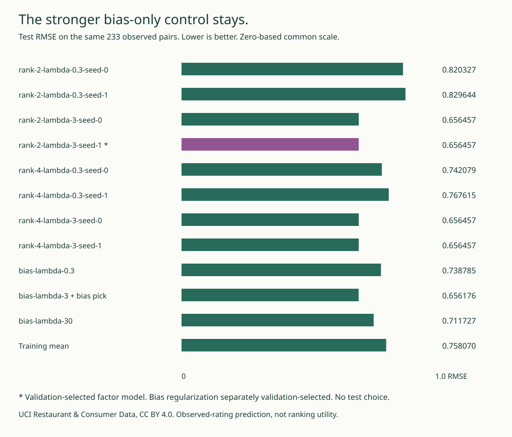

# RatingLab

RatingLab fits explicit ratings with NumPy alternating ridge solves. Only
observed user/item pairs enter the loss; zero is a real rating, not a missing
value. The browser shows score terms, normal equations, objective histories
and coordinate rotations.

A separately selected bias-only control slightly outperforms the factor model
on the fixed test split. Both remain visible.

## What runs

- Eight biased factor fits: ranks 2/4, regularization .3/3, seeds 0/1. Joint bias-plus-factor user and item updates solve explicit positive-definite normal systems.
- Three independently validation-selected bias-only fits, plus a training-mean control. No weakened zero-filled SVD control.
- Every block checks objective decrease, normal residual and full half-pass objective telescoping. Every half-pass retains the full objective and full-gradient maximum. Block optimality is not global optimality.
- Frozen original UCI overall ratings: 1,161 observed pairs, 138 users, 130 items. Train/validation/test = 696/232/233. Zero is a real rating; missing pairs never enter the loss.
- Separate scalar JavaScript inference checks all 12,771 model/observed-pair predictions. Real Chrome verifies eleven models, 33 user/item UI states, actual keyboard rotation, invalid-input recovery, clipboard denial/success, JSON download and 320/390/1280 layouts.
- Sixty independent exact Fraction ridge-solve references, all model-gradient coordinates checked by central differences, eleven fresh fits, exact saved browser-export reproduction and test-label poisoning.

## Fixed-split results

Validation chooses `rank-2-lambda-3-seed-1`. On the frozen 233 test observations:

| Fixed predictor | Raw test RMSE, lower is better |
|---|---:|
| Validation-selected factor model | 0.656457 |
| Separately validation-selected bias-only control | **0.656176** |
| Training mean | 0.758070 |

The factor model does not beat the stronger control on this split. The difference is small; it is not a significance or general-ranking claim. All eight factor fits exhaust their 80-sweep full-gradient budget. Two bias fits meet the numerical gradient tolerance; nothing is labeled a global optimum.



## Reproduce

Python 3.10+, NumPy 2.2.6. Runs offline after installation. No sklearn, model API or private user data.

```sh
python -m pip install -e .
OPENBLAS_NUM_THREADS=1 python -m unittest discover -s tests -v
python -m ratinglab report
python -m ratinglab audit
python -m ratinglab fit --output fresh.json
python -m ratinglab audit --report fresh.json
python -m ratinglab controls
python -m ratinglab witness --side item --index 84
python -m ratinglab.export
python examples/figure.py
node --test tests/*.cjs
```

Chrome and Node 22+ are required for the actual browser check. Set `CHROME_BIN` when needed. `fit --budget 0` deliberately preserves an unfinished initial state.

Strict input: `{"pairs":[[0,0],[137,129]]}`. These are known stable user/item indices, not source identifiers or user characteristics. Unknown indices, booleans, fractional indices, duplicate keys, nonfinite JSON and extra fields fail.

```sh
python -m ratinglab predict --input pairs.json
python -m pip wheel . --no-deps -w /tmp/wheels
python -m pip install --target /tmp/installed /tmp/wheels/ratinglab-0.3.0-py3-none-any.whl
bash examples/verify_wheel.sh /tmp/installed "$PWD"
```

The current suite has 37 Python and fourteen Node/actual-Chrome tests. The installed wheel imports all ten modules including the package root and exercises eight main CLI commands plus two single-row module commands outside checkout, including all eleven fresh fits and complete saved/fresh fit audits. The browser exporter does not fit. Bounded per-candidate JSON artifacts reconstruct the full report without rounding. The original source CSV is retained byte-for-byte with a checked SHA256.

## Interpretation and limits

The observed edge split is not chronological or a new-user/new-item test. All held-out entities happen to be warm; zero-factor cold fallback is only checked in a supplied synthetic control. An index lookup is not a learned cold-start preference model.

A shared orthogonal rotation leaves scores and the ridge penalty unchanged while changing individual coordinate products. Those products are algebraic terms, not identified taste axes or causal importance. A supplied exactly stationary all-zero factor point has objective 4 while a feasible nonzero factorization has objective 0.4. A numerical stationarity criterion alone cannot certify a global optimum.

Observed ratings are selected by their original data collection process. RMSE here does not measure missing-pair accuracy, top-N relevance, satisfaction or causal preferences. Raw scores can fall outside [0,2]; clipping is separately reported and does not determine selection. This is not restaurant advice.

Original public UCI data is CC BY 4.0. No consumer profiles, names, restaurant metadata, coordinates, demographics, food/service auxiliary targets or private ratings are used in fitting or in the browser. The original five-column CSV is retained only as source evidence; only its user ID, item ID and overall-rating columns are read. [METHOD.md](METHOD.md) gives equations, hashes, split rules, source attribution and limits. MIT code; established methods, original implementation, no source-author endorsement.


## Full fits and conditional edits

`fit` updates both user and item parameters. The single-row inspector instead
changes one rating while holding the mean, penalty and opposite-side parameters
fixed. The batch inspector changes several rows in that same conditional block.
Neither conditional calculation is full-model retraining or data unlearning.

## v0.2: single-row conditional response

[Conditional edit/deletion inspector](https://midya8.github.io/ratinglab/influence.html) · [Derivation and limits](INFLUENCE.md)

Change or remove one training rating with the mean, penalty and every opposite-side bias/factor frozen. The browser separates the original saved score, a fresh unmodified conditional baseline and the changed conditional score. A target edit has a finite linear response; a row deletion uses its residual and Sherman-Morrison denominator. The saved user block may move on re-solving even before the edit, so that movement stays separate.

The extension adds 60 independent rational design references, all 2,784 selected-model/control training-row deletion checks against fresh conditional solves and 576 native/scalar-JavaScript vector/leverage/query witnesses. That release had thirty Python and nine Node/real-Chrome tests, including physical keyboard edits, invalid-input recovery, copy/download and 320/390/1280 layouts. Its eight-module installed wheel ran the original six commands plus `python -m ratinglab.influence demo` and `python -m ratinglab.influence references --output /tmp/influence-reference.json`.

This is not full-model leave-one-out cross-validation or unlearning: frozen opposite factors and the training mean retain information from the original row. No causal influence, confidence interval or retraining bound is claimed. All original fits, scores, split, rating bytes, original score inference and original figure remain unchanged. The stronger bias-only control still slightly wins the original test.

## Joint conditional batches, v0.3.0

[Open the batch inspector](https://midya8.github.io/ratinglab/batch.html) or read [BATCH.md](BATCH.md). Select multiple original training rows in one frozen user/item ridge block. Finite target edits add; joint deletions solve a coupled Schur system and generally differ from a sum of separate-original-baseline deletions. Empty/full/single cases, conservative positivity bound, condition refusal, saved-versus-re-solved baseline, independent rational/direct least-squares checks and source-bound JSON stay visible. This is not full ALS retraining, causal influence, cross-validation or data unlearning. Original fits, splits and metrics are unchanged.
